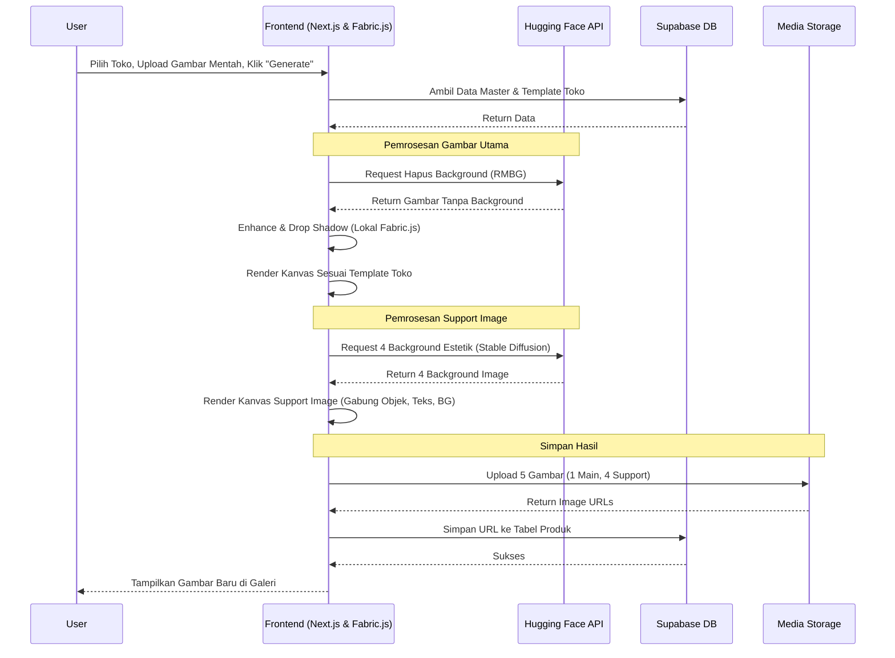

# Product Requirement Document (PRD)
## Aplikasi Image Generator & Editor Produk E-Commerce

### 1. Pendahuluan
#### 1.1 Tujuan
Membangun aplikasi web untuk mempermudah sistem analis dan tim konten dalam memproduksi, mengedit, dan mengelola gambar produk untuk kebutuhan unggah ke berbagai platform e-commerce. Aplikasi ini ditujukan untuk mengotomatisasi pembuatan gambar produk yang elegan, seragam sesuai identitas toko, namun tetap memiliki variasi visual yang menarik menggunakan bantuan AI.

#### 1.2 Ruang Lingkup
Aplikasi ini meliputi sistem manajemen master data (Brand, Shop, Product), pengaturan template visual per toko, serta mesin *generator* gambar produk yang dilengkapi dengan kemampuan AI (penghapus latar belakang, pencerah gambar, dan penambah bayangan).

---

### 2. Kebutuhan Fitur (Feature Requirements)

#### 2.1 Autentikasi Pengguna
*   **Fitur Login User:** Pengguna harus masuk ke dalam sistem menggunakan kredensial (username/email dan password) sebelum dapat mengakses fitur-fitur di dalam aplikasi.

#### 2.2 Manajemen Brand (CRUD Brand)
*   **Data Tersimpan:** Nama Brand, Logo Brand.
*   **Antarmuka (UI):** Tampilan daftar (list) tidak menggunakan tabel konvensional, melainkan menggunakan model **Image Gallery** (grid view). Setiap item menampilkan Logo Brand dalam sebuah *card* yang rapi, dengan Nama Brand di bawahnya. Ini membuat UI terlihat lebih modern dan tidak kaku.

#### 2.3 Manajemen Toko (CRUD Shop)
*   **Data Tersimpan:** Nama Shop, Logo Shop.
*   **Antarmuka (UI):** Tampilan daftar menggunakan model **Image Gallery**, serupa dengan halaman Brand.
*   **Fitur Template Setting:** Setiap toko (shop) memiliki halaman pengaturan template sendiri yang digunakan sebagai dasar pembuatan gambar produk.
    *   **Tata Letak (Layout):** Pengaturan posisi untuk setiap komponen pada kanvas gambar.
    *   **Komponen Teks:**
        *   Pemilihan Font: Menyediakan font standar sistem serta penambahan custom font **Agradir** dan **Comfortaa**.
        *   Pengaturan ukuran teks (font size).
        *   Pengaturan warna teks.
    *   **Komponen Gambar:** Pengaturan ukuran untuk logo toko maupun logo brand pada kanvas.
    *   **Simpan Template:** Template yang telah diatur akan disimpan ke database dan otomatis dipanggil saat proses *generate image* untuk toko tersebut.

#### 2.4 Manajemen Produk (CRUD Product)
*   **Data Master:** Nama Produk, Deskripsi, relasi ke Brand.
*   **Galeri Gambar Produk:** Tempat penyimpanan dan pratinjau (preview) untuk gambar-gambar produk (Product Image) yang merupakan hasil dari fitur *Generate Product Image*.
*   **Aksi:** Pengguna dapat mempratinjau (preview) hasil gambar ukuran penuh dan mengunduh (download) gambar tersebut untuk diunggah ke e-commerce.

#### 2.5 Generate Product Image
*   **Lokasi Fitur:** Berada di dalam halaman detail/master masing-masing produk.
*   **Mekanisme Pemilihan Toko:** Terdapat daftar *checklist* toko (shop). Pengguna dapat memilih satu atau beberapa toko sekaligus untuk dibuatkan gambarnya secara massal.
*   **Input Data:**
    *   **Product Title:** Diambil dari data master produk. (Mendukung format multiline/enter, teks tidak boleh terpotong sembarangan).
    *   **Brand Logo:** Diambil otomatis dari relasi master Brand.
    *   **Shop Logo:** Diambil otomatis berdasarkan *checklist* toko yang dipilih.
    *   **Gambar Mentah (Raw Image):** Diunggah manual (upload) oleh pengguna dengan format `.png` atau `.jpg`.
*   **Pemrosesan dengan AI (Gratisan):**
    *   **Background Removal:** Menghapus latar belakang gambar mentah secara otomatis.
    *   **Image Enhancement:** Membuat subjek gambar lebih cerah dan tajam tanpa mendistorsi desain produk atau teks yang ada pada produk itu sendiri.
    *   **Shadow Effect:** Memberikan efek bayangan (drop shadow) pada subjek gambar yang telah dihilangkan latar belakangnya agar terlihat lebih *pop-out* dan elegan.
*   **Output (Hasil Generate):**
    *   **Main Product Image:** Gambar utama hasil penggabungan template toko dengan gambar produk yang telah diproses AI. Jumlah gambar yang dihasilkan sama dengan jumlah *checklist* toko yang dipilih.
    *   **Support Product Image:** Menghasilkan 4 variasi gambar pendukung menggunakan model AI gratisan. Konten pada gambar pendukung ini meliputi perpaduan dinamis dari: Judul Produk, Deskripsi Produk, Gambar Produk yang diproses, dan Logo Brand.
*   **Tombol Eksekusi:** Sebuah tombol "Generate" besar untuk memulai proses komputasi.

*   **Sequence Diagram Alur Generate Image:**

---

### 3. Arsitektur & Tech Stack Final

*   **Framework & Frontend:** Next.js (React) dipadukan dengan Tailwind CSS. Memberikan performa tinggi dan kemudahan membuat UI image gallery yang modern.
*   **Hosting & CI/CD:** Netlify. Terhubung langsung dengan Git Anda untuk deployment otomatis, memanfaatkan Serverless Functions untuk memproses panggilan API secara aman.
*   **Database & Autentikasi:** Supabase. Menangani login user dan penyimpanan data relasional (PostgreSQL) untuk entitas Brand, Shop, dan Product.
*   **Media Storage:** Cloudinary (direkomendasikan) atau Supabase Storage untuk menyimpan logo, aset gambar mentah, dan hasil akhir.
*   **Canvas Engine:** Fabric.js (berjalan di client-side/browser). Digunakan sebagai mesin utama untuk fitur "Template Setting", manipulasi layout, kustomisasi teks (termasuk font Agradir & Comfortaa), dan rendering gambar akhir.

### 4. Strategi Pemrosesan Gambar & AI

*   **Hapus Background:** Menggunakan Hugging Face Inference API (misal: model briaai/RMBG-1.4) untuk memotong objek produk dari latar belakang secara presisi dan gratis.
*   **Enhancement (Kecerahan, Ketajaman, & Drop Shadow):** Dieksekusi secara lokal di browser menggunakan Fabric.js. Pendekatan non-AI ini menjamin teks/desain pada kemasan produk tetap utuh, aman, dan memangkas beban server.
*   **Generate 4 Support Product Image:** Menggunakan Stable Diffusion via Hugging Face API untuk menciptakan background scene estetik secara otomatis, yang kemudian digabungkan dengan gambar produk utama beserta teks pendukung (judul, deskripsi) melalui kanvas.
